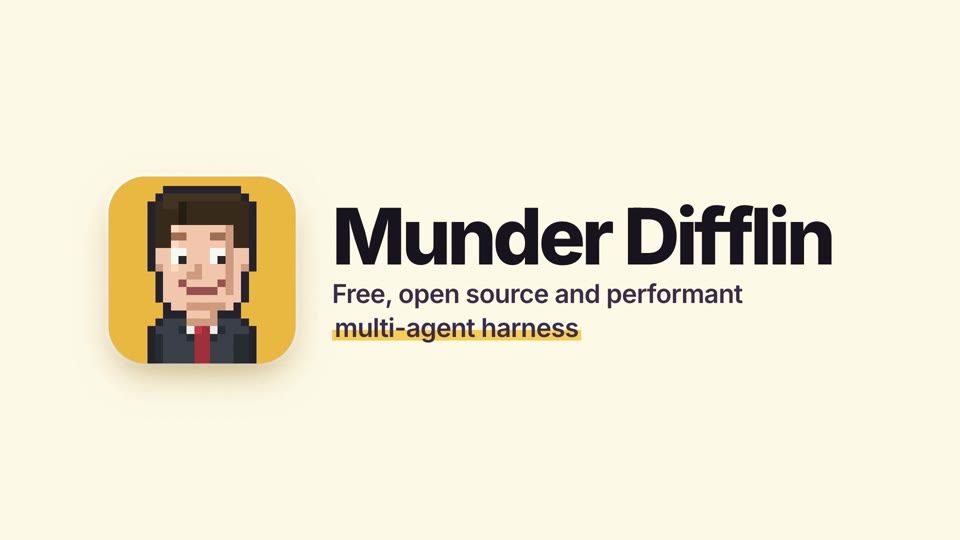
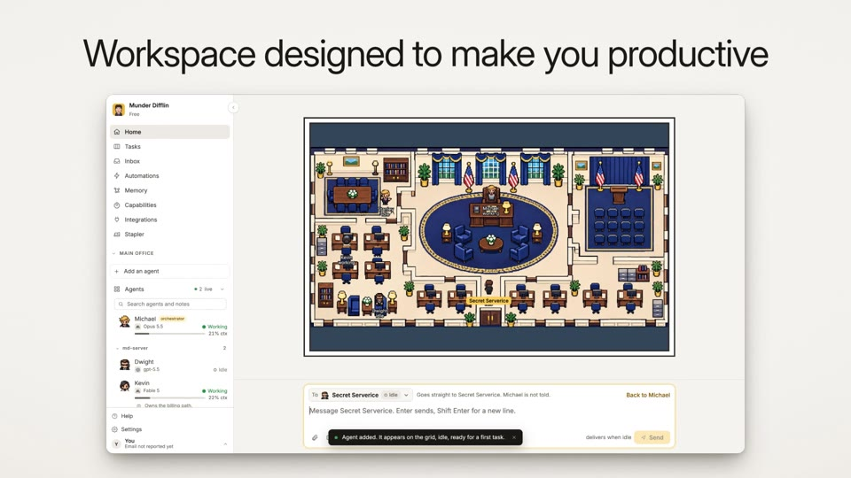

# launch-video skill

Make a product launch film end to end with an AI coding agent, then iterate on it.
The agent interviews you (brand, a one minute voice note about the idea, example videos,
assets, design, spend), studies your examples, finds missing assets and writes prompts to
make them, writes the script and shot list for your approval, builds the film in code with
HyperFrames, renders it, reviews every frame, and delivers a master, a share copy and stems.
Then send notes in any words and it makes the next version.

It is the process the Munder Difflin team uses for its own launch films, with the lessons
from every round of feedback built in (`references/lessons.md`).

Works in Claude Code and Codex.

## Examples

Two launch films made with this process for [Munder Difflin](https://munderdiffl.in). Click a still to play it.

| [](https://github.com/chaitanyagiri/launch-video-skill/releases/download/examples/munder-difflin-launch.mp4) | [](https://github.com/chaitanyagiri/launch-video-skill/releases/download/examples/munder-difflin-reason-remake.mp4) |
|---|---|
| **Launch film** (Sep 2026, 50.6 s, 1080p60). Real app screens, big type, fast cuts and a full sound effects pass. | **Reason remake** (Nov 2026, 36.7 s, 1080p60). A pacing study of the Reason Machines intro, rebuilt with real Munder Difflin screens. Structure and music are from the original and remain theirs. |

Both files are on the [Example launch films](https://github.com/chaitanyagiri/launch-video-skill/releases/tag/examples) release, not in the skill folder, so installs stay small.

## Start with one prompt

Paste this into Claude Code, Codex or any coding agent, in the folder where you want the
film to live. It installs everything and starts the first questionnaire.

```text
Set up the launch-video skill (https://github.com/chaitanyagiri/launch-video-skill) and start my first launch video.

1. Check my machine: node -v (18 or newer), ffmpeg -version, python3 -c "import numpy", git --version. For anything missing, tell me the exact install command for my system and wait for my OK before installing it.
2. Install the skill: npx skills add chaitanyagiri/launch-video-skill -g -y
   If that fails, clone the repo into your skills folder instead (Claude Code: ~/.claude/skills/launch-video, Codex: ~/.agents/skills/launch-video). If you have no skills folder, clone it to ./.launch-video-skill.
3. Install the HyperFrames skills it builds with: npx skills add heygen-com/hyperframes -g -y --skill '*'
   Then check that npx hyperframes --version works.
4. Optional, ask me before each: yt-dlp (to download my example links), the Agent Reach skill (https://github.com/Panniantong/Agent-Reach) for X, Instagram and TikTok links, and whisper or an ElevenLabs key to transcribe my voice note.
5. Tell me in a few lines what is installed and what is still missing.
6. Read the installed SKILL.md now (do not wait for a restart) and follow it in CREATE mode. Ask the spend question first (Lean, Standard or Max), then the questionnaire one round at a time: my brand, a one minute voice note about the idea, example videos, my product and assets, format and sound, words and rules. Save my answers in a launch/ folder here as you go. Do not research, write or build anything until I confirm the intake summary.
```

Next time, in any session, just say "make a launch video for my app" or "change scene 2 of
my launch video".

## Install

With the skills CLI (it asks which agent to install into):

```bash
npx skills add chaitanyagiri/launch-video-skill -g
npx skills add heygen-com/hyperframes -g --skill '*'   # the HyperFrames skills it builds with
```

Or clone it straight into your skills folder:

```bash
# Claude Code
git clone https://github.com/chaitanyagiri/launch-video-skill ~/.claude/skills/launch-video
# Codex
git clone https://github.com/chaitanyagiri/launch-video-skill ~/.agents/skills/launch-video
```

Needs Node 18+, ffmpeg and Python 3 with numpy. Optional: yt-dlp (download example links),
the agent-reach skill (https://github.com/Panniantong/Agent-Reach) for X, Instagram and
TikTok links, whisper or an ElevenLabs key (voice note transcript).

## Use

- New film: "make a launch video for my app" or `/launch-video create`.
- Change a film: "make scene 2 slower and the background lighter" or `/launch-video iterate`.

The first question is how much to spend: Lean, Standard or Max. It decides how many
examples are studied and which models write and build (Fable 5.2 or GPT 6.2 Astra for
writing, Opus 5.5 at max effort or Fable 5.2 for the build). See
`references/budget-and-models.md`.

Everything lives in a `launch/` folder in your working directory, so any session can pick
up where the last one stopped.

## What it will not do

Invent product screens, put a claim on screen without a source, ship a placeholder, copy
another film's story or music, or clone a real person's voice without consent.

## Licence

MIT, see `LICENSE`.
